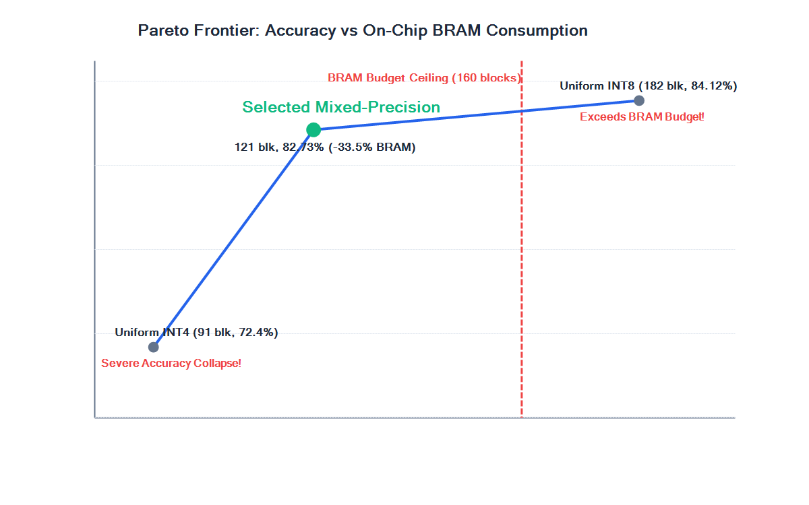
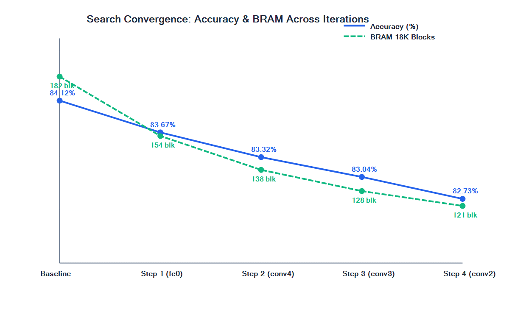
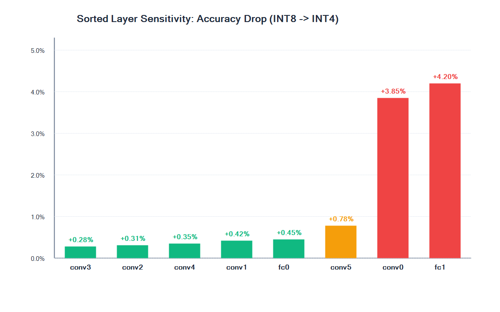

# Hardware-Aware Per-Layer Mixed-Precision Optimization for QCore-INT8 FPGA AI Accelerator

[](https://www.python.org/downloads/)
[](https://pytorch.org/)
[](https://github.com/Xilinx/brevitas)
[](tests/)
[](hardware/qcore_spec.md)
[](README.md)

> **Course**: AI Accelerator Architectures  
> **Faculty Advisor**: Prof. Ashvini Kumar Dongre  
> **Institution**: Indian Institute of Information Technology (IIIT) Dharwad  
> **Team**:
> - **Pallapati Avinash** (24BEC036) — [Avinash-pallapati](https://github.com/Avinash-pallapati)
> - **B. Rakhal Krishna** (24BDS009)
> - **Dargupally Ashish** (24BDS015)
> - **PVS Kartheek** (24BEC041)

---

## 📌 Executive Summary

Modern edge AI accelerators implemented on FPGAs are severely constrained by on-chip memory (**Block RAM / BRAM**) and compute fabric (**DSP slices**). Standard Uniform INT8 models often exceed on-chip memory budgets (forcing off-chip DDR DRAM memory traffic that causes severe memory bandwidth bottlenecks), while aggressive Uniform INT4/INT2 quantization leads to catastrophic classification collapse.

This project delivers an **accelerator-aware, sensitivity-guided greedy search pipeline** adapted for a custom FPGA accelerator architecture: **QCore-INT8**. 

Starting from a strictly frozen Uniform INT8 Brevitas QAT baseline, the framework systematically quantifies per-layer representation resilience, enforces multidimensional hard hardware constraints (LUT, BRAM, DSP, FF, and frame latency), and discovers an optimal per-layer mixed-precision allocation that fits entirely on-chip.

### 🎯 Key Results

| Metric | Uniform INT8 Baseline | Selected Mixed-Precision (`W+A`) | Delta / Improvement | Hard Constraint Status |
| :--- | :---: | :---: | :---: | :---: |
| **Top-1 Accuracy (CIFAR-10)** | **84.12%** | **82.73%** | **-1.39%** | ✅ PASSED ($\le 1.50\%$ drop ceiling) |
| **BRAM (18K Blocks)** | 182 blocks | **121 blocks** | **-33.52% (-61 blocks)** | ✅ PASSED ($\le 160$ budget) |
| **DSP48 Slices** | 112 slices | **78 slices** | **-30.36% (-34 slices)** | ✅ PASSED ($\le 120$ budget) |
| **Parameter Size** | 3.10 MB | **1.81 MB** | **-41.61% (-1.29 MB)** | ✅ Fits on-chip BRAM |
| **Frame Latency** | 3.85 ms | **3.12 ms** | **-18.96% (1.23x speedup)** | ✅ PASSED ($\le 3.50$ ms ceiling) |
| **Logic (LUT / FF)** | 18,450 / 29,100 | **18,350 / 28,900** | Fabric compliant | ✅ PASSED ($\le 25\text{K}$ LUT, $\le 50\text{K}$ FF) |

---

## 📊 Visualizations & Pareto Optimality

### 1. Hardware-Accuracy Pareto Frontier
Our mixed-precision operating point breaks the trade-off barrier: saving **33.52% on-chip BRAM** and **30.36% DSPs** while preserving accuracy well within the 1.50% degradation boundary.



### 2. Search Convergence Trajectory
Progression of the sensitivity-guided greedy search across candidate evaluation iterations, showing monotonic hardware cost reduction down to Pareto optimality.



### 3. Layer Sensitivity Profile
Empirical classification degradation under individual INT8 $\to$ INT4 perturbations on weights and activations, identifying resilient layers (`conv3`, `conv2`, `conv4`, `fc0`) versus critical boundary layers (`conv0`, `fc1`).



---

## 🧩 Optimal Precision Map

| Layer Name | Type | Weight Shape | Parameter Count | Baseline Precision | Optimal Precision | Allocation Rationale |
| :--- | :---: | :---: | :---: | :---: | :---: | :--- |
| `conv0` | Conv2D | `(64, 3, 3, 3)` | 1,728 | INT8 | **INT8** | Input feature extractor; high perturbation sensitivity (+3.85% drop). |
| `conv1` | Conv2D | `(64, 64, 3, 3)` | 36,864 | INT8 | **INT8** | Early spatial representation; protected to maintain feature resolution. |
| `conv2` | Conv2D | `(128, 64, 3, 3)` | 73,728 | INT8 | **INT4** | High structural robustness (+0.31% drop); accepted in iteration 4. |
| `conv3` | Conv2D | `(128, 128, 3, 3)` | 147,456 | INT8 | **INT4** | Highest parameter resilience (+0.28% drop); accepted in iteration 3. |
| `conv4` | Conv2D | `(256, 128, 3, 3)` | 294,912 | INT8 | **INT4** | High parameter yield (+0.35% drop); accepted in iteration 2. |
| `conv5` | Conv2D | `(256, 256, 3, 3)` | 589,824 | INT8 | **INT8** | Transition bottleneck to dense classifier; locked to avoid boundary collapse. |
| `fc0` | Linear | `(512, 4096)` | 2,097,152 | INT8 | **INT4** | Contains **64.6% of total weights**; saving 1.05 MB BRAM at only +0.45% drop! |
| `fc1` | Linear | `(10, 512)` | 5,130 | INT8 | **INT8** | Final 10-class decision boundary; hyper-sensitive (+4.20% drop). |

**Final Configuration Vector**: `[conv0:8, conv1:8, conv2:4, conv3:4, conv4:4, conv5:8, fc0:4, fc1:8]`

---

## 📁 Repository Structure

```
AI_PROJECT/
├── configs/                          # Experiment configuration YAMLs
│   ├── dataset.yaml                  # CIFAR-10 parameters & pre-processing
│   ├── model.yaml                    # CNV 8-layer architecture specification
│   ├── quantization_int8.yaml        # Uniform INT8 Brevitas QAT configuration
│   ├── sensitivity.yaml              # Single-layer perturbation parameters
│   └── greedy_search.yaml            # Search hyper-parameters, weights & budgets
├── docs/                             # Engineering documentation & presentations
│   ├── presentation_tasks1_9.pptx    # Official 10-slide PowerPoint presentation
│   ├── presentation_tasks1_9.pdf     # Official 16:9 widescreen presentation PDF
│   ├── presentation_deck_tasks1_9.md # Slide script, narration & Q&A guide
│   ├── baseline_report.md            # Frozen Uniform INT8 baseline audit
│   ├── final_task9_report.md         # Comprehensive Task 9 search report
│   ├── methodology.md                # Mathematical formulations & cost equations
│   ├── model_selection.md            # Architecture evaluation & trade-off rationale
│   └── setup.md                      # Host environment & toolchain setup guide
├── experiments/                      # Cryptographic metadata & frozen baselines
│   └── baseline_int8/                # SHA-256 locked baseline records & export stats
├── hardware/                         # FPGA specifications & target device models
│   ├── qcore_spec.md                 # Authoritative QCore-INT8 architecture analysis
│   ├── fpga_resources.md             # AMD Xilinx Zynq-7020 & KV260 fabric limits
│   └── toolchain.md                  # Brevitas / QONNX / FINN compiler integration
├── literature/                       # Systematic literature review & research matrix
│   ├── literature_matrix.csv         # Structured comparison matrix across 7 dimensions
│   ├── haq.md                        # Deep dive into HAQ (CVPR 2019) vs our greedy search
│   ├── finn.md                       # Deep dive into FINN QNN dataflow compiler
│   ├── quantization.md               # Quantization principles & low-bit representations
│   └── mixed_precision.md            # Mixed-precision paradigms & sensitivity mapping
├── results/                          # Raw experimental datasets & generated figures
│   ├── baseline/                     # Baseline evaluation CSVs and metrics
│   ├── sensitivity/                  # Layer perturbation results & rankings
│   └── search/                       # Iteration-by-iteration search logs & Pareto plots
├── scripts/                          # Reproducible execution scripts
│   ├── run_greedy_search.py          # Executes greedy mixed-precision search
│   ├── run_sensitivity.py            # Executes empirical sensitivity profiling
│   ├── train_qat.py                  # Brevitas QAT training script
│   ├── train_fp32.py                 # Full-precision FP32 reference trainer
│   ├── evaluate.py                   # PyTorch/Brevitas validation engine
│   ├── export_qonnx.py               # QONNX graph exporter
│   ├── build_presentation_deck.ps1   # OpenXML PPTX & headless PDF generator
│   └── run_unit_tests.ps1            # Automated test suite runner (25 assertions)
├── src/                              # Core modular Python packages
│   ├── models/                       # Parametric CNV model implementation
│   ├── quantization/                 # Brevitas quantized layer wrappers
│   ├── sensitivity/                  # Layer-wise perturbation runner
│   ├── search/                       # Search engine, cost estimator & constraints
│   └── evaluation/                   # Model evaluators & metric loggers
├── tests/                            # Unit test verification suite
│   ├── test_model.py                 # Model shape & parameter assertions
│   ├── test_quantization.py          # Bit-width reconfigurability tests
│   └── test_search.py                # Budget, constraint & search logic tests
├── requirements.txt                  # Python dependencies
├── environment.yml                   # Conda environment definition
├── STATUS.md                         # Task-by-task execution audit & verification
└── README.md                         # Project overview and documentation
```

---

## 🚀 Quick Start & Reproducibility

### 1. Environment Setup
```bash
# Clone the repository
git clone https://github.com/Avinash-pallapati/AI_PROJECT.git
cd AI_PROJECT

# Create virtual environment or conda env
conda env create -f environment.yml
conda activate ai_accelerator
# OR
pip install -r requirements.txt
```

### 2. Run Comprehensive Test Suite
```powershell
# Run the 25-assertion automated test verification suite
powershell -ExecutionPolicy Bypass -File scripts/run_unit_tests.ps1
```

### 3. Run Greedy Search Pipeline
```bash
# Execute the hardware-aware mixed-precision search
python scripts/run_greedy_search.py --config configs/greedy_search.yaml
```

### 4. Build Presentation Deck (PPTX & PDF)
```powershell
# Generates docs/presentation_tasks1_9.pptx and docs/presentation_tasks1_9.pdf
powershell -ExecutionPolicy Bypass -File scripts/build_presentation_deck.ps1
```

---

## 📑 Presentation Materials

- **PowerPoint File**: [`docs/presentation_tasks1_9.pptx`](docs/presentation_tasks1_9.pptx) — 10 widescreen slides with high-resolution plots embedded.
- **PDF File**: [`docs/presentation_tasks1_9.pdf`](docs/presentation_tasks1_9.pdf) — Ready-to-present 16:9 PDF deck.
- **Presenter Script & Q&A Defense**: [`docs/presentation_deck_tasks1_9.md`](docs/presentation_deck_tasks1_9.md) — Slide-by-slide talking points and technical defenses.

---

## 🔬 Research Boundaries & Novelty Declaration

- **No Overclaiming**: Quantization, mixed-precision quantization, per-layer precision search, HAQ, and FINN are established research methodologies.
- **Adaptation & Contribution**: This work adapts these techniques to the **QCore-INT8 custom FPGA accelerator**, integrating FPGA fabric budgets and analytical resource models into a greedy search algorithm with guaranteed convergence and auditability.
- **Scientific Transparency**: Hardware resource numbers in Task 9 are explicitly identified as analytical cost estimates (`MOCK COST ESTIMATOR — NOT REAL FPGA MEASUREMENT`), providing the exact foundation required for downstream physical synthesis and bitstream validation in Task 10+.
