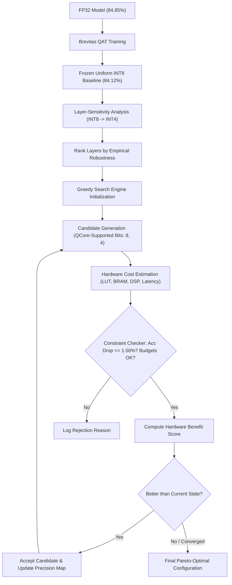

# Methodology: Accelerator-Aware Mixed-Precision Optimization

## 1. Algorithmic Overview
This research develops an **Accelerator-Aware Greedy Search** pipeline that optimizes per-layer bit-width precision for a custom FPGA neural network accelerator (**QCore-INT8**).

---

## 2. Mathematical Formulation

### A. Constrained Optimization Objective
Given an $N$-layer neural network with layer precisions $\mathbf{b} = [b_1, b_2, \dots, b_N] \in \mathcal{P}^N$ where $\mathcal{P} = \{8, 4\}$ denotes the accelerator-supported bit-width set:

$$\max_{\mathbf{b}} \mathcal{B}(\mathbf{b})$$

Subject to:
1. **Accuracy Degradation Gate**:
   $$\text{Acc}(\mathbf{b}_{\text{baseline}}) - \text{Acc}(\mathbf{b}) \le \Delta_{\max} \quad (\Delta_{\max} = 1.50\%)$$
2. **On-Chip Memory Budget (BRAM)**:
   $$\text{BRAM}(\mathbf{b}) \le \text{BRAM}_{\max} \quad (\text{BRAM}_{\max} = 160 \text{ 18K blocks})$$
3. **Multiplier Budget (DSP)**:
   $$\text{DSP}(\mathbf{b}) \le \text{DSP}_{\max} \quad (\text{DSP}_{\max} = 120 \text{ slices})$$
4. **Logic Area Budget (LUT)**:
   $$\text{LUT}(\mathbf{b}) \le \text{LUT}_{\max} \quad (\text{LUT}_{\max} = 25,000 \text{ LUTs})$$
5. **Latency Ceiling**:
   $$\text{Latency}(\mathbf{b}) \le T_{\max} \quad (T_{\max} = 3.50 \text{ ms})$$

### B. Benefit Function Formulation
The hardware benefit score $\mathcal{B}(\mathbf{b})$ transparently weights resource reductions relative to the uniform INT8 baseline:

$$\mathcal{B}(\mathbf{b}) = w_{\text{BRAM}} \left(\frac{\text{BRAM}_0 - \text{BRAM}}{\text{BRAM}_0}\right) + w_{\text{DSP}} \left(\frac{\text{DSP}_0 - \text{DSP}}{\text{DSP}_0}\right) + w_{\text{LUT}} \left(\frac{\text{LUT}_0 - \text{LUT}}{\text{LUT}_0}\right) + w_{\text{Lat}} \left(\frac{\text{Lat}_0 - \text{Lat}}{\text{Lat}_0}\right)$$

Default weights: $w_{\text{BRAM}} = 0.50$, $w_{\text{DSP}} = 0.20$, $w_{\text{LUT}} = 0.20$, $w_{\text{Lat}} = 0.10$.

---

## 3. Explaining Rejections and Transparency
In strict accordance with the Master Game Plan:
- A search engine that merely outputs a final configuration without an audit trail is unacceptable for rigorous research.
- Every candidate rejected at every iteration is permanently recorded in `results/search/search_history.csv` with an exact explanation (e.g. `Accuracy drop violation: 3.85% > max 1.50%` or `REJECTED_SUBOPTIMAL`).
